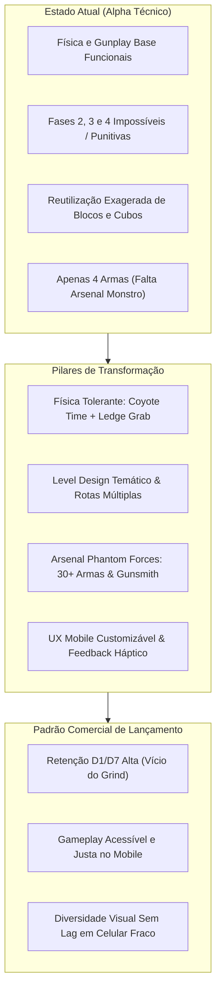
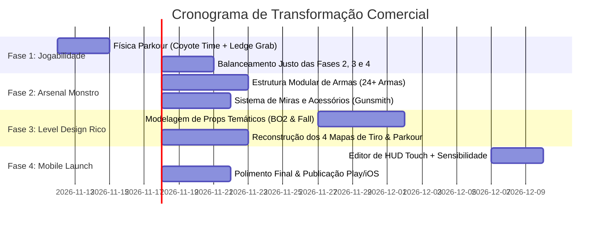

# 📋 Diagnóstico Estratégico de Lançamento: SAKURA BLITZ
**De Protótipo Divertido a Sucesso Comercial (Google Play, iOS & PC Crossplay)**

---

## 1. Visão Geral & Avaliação Sincera do Estado Atual

O jogo atingiu um marco crucial: **a base técnica e a sensação inicial são divertidas**. O ritmo rápido, o feedback de abates (*Kill Siphon* e *Adrenaline Rush*), o shader PSX estável e a esteira de build automatizada para a nuvem provam que o motor está sólido.

Porém, para ser um jogo que os jogadores baixam no celular, avaliam com **5 estrelas** e jogam todos os dias (como *Phantom Forces* no Roblox ou *Standoff 2* e *Free Fire* nas lojas móveis), **há gargalos críticos que precisam ser corrigidos**.

---

## 2. Diagnóstico dos Pontos Críticos

### 🔴 A. Modo Parkour: O Problema das Fases 2 em Diante
> [!WARNING]
> No estado atual, as pistas 2, 3 e 4 sofrem de **"Dificuldade Injusta"**, que afasta o jogador mobile em vez de engajar.

1. **Gaps Matematicamente Punitivos**: A distância entre as plataformas exige saltos no milissegundo exato do último pixel da borda. Em telas de toque (touchscreen), a falta de resposta tátil faz com que 90% dos pulos falhem.
2. **Ausência de Mecânicas de Salvação (*Coyote Time* & *Ledge Grab*)**:
   - **Coyote Time**: Permitir que o jogador ainda pule por 0.15s após sair da beirada da plataforma (como em *Celeste* e *Fall Guys*).
   - **Ledge Grab / Mantle**: Se o jogador bater o peito na quina da plataforma, o personagem deve puxar o corpo para cima automaticamente em vez de escorregar para a morte no abismo.
3. **Fadiga Visual por Repetição de Caixas**: As pistas usam a mesma estética de blocos geométricos repetidos. No *Fall Guys*, cada fase tem um tema marcante: infláveis com física elástica, esteiras rolantes velozes, ventiladores gigantes de ar ascendente e escorregadores de lama.
4. **Falta de Caminhos Alternativos (*Risk vs. Reward*)**: Uma fase de Fall Guys nunca é um único fio estreito. Deve haver:
   - **Rota Segura**: Mais longa, com plataformas largas, para novatos e bots lentos.
   - **Rota Arriscada**: Atalho estreito com martelo giratório, que economiza 15 segundos para quem domina o timing.

---

### 🔴 B. Modo Tiro: O Que Falta para Chegar no Padrão *Phantom Forces*
> [!IMPORTANT]
> O segredo do vício de *Phantom Forces* não é apenas dar tiro: é a **profundidade do arsenal** e a **sensação de progressão contínua**.

| Elemento | Estado Atual | O Que o Phantom Forces Faz | O Que Precisamos Implementar |
|---|---|---|---|
| **Catálogo de Armas** | 4 armas (AK, AWP, Deagle, Karambit) | Mais de 100 armas categorizadas | **Catálogo Modular com 24 a 32 Armas** (divisão por classes reais: Rifles de Assalto, Submetralhadoras, Snipers, Shotguns, DMRs e Pistolas). |
| **Acessórios (Gunsmith)** | Sem acessórios no modelo | Miras, canos, grips, lasers e pentes | **Sistema de Acessórios Desbloqueáveis por Kills**: Red Dot, Holográfica, Luneta 4x, Silenciador, Compensador e Grip Estabilizador. |
| **Padrões de Recuo (Recoil)** | Recuo vertical simples | Padrões únicos de recuo por arma | Recuo cinemático com animação procedural de câmera e dispersão de disparos balanceada. |
| **Level Design de Arenas** | Blocos e contêineres geométricos | Arenas icônicas (*Desert Storm, Crane Site, Ravod 911*) | **Arquitetura Tática com 3 Rotas**: Choke points centrais para rush, rotas de flanco para snipers e áreas fechadas para CQC. |

---

## 3. O Que Falta para o Lançamento Comercial (Play Store / iOS / PC)

Para colocar o jogo na loja e gerar downloads orgânicos com boa retenção, precisamos fechar 4 pilares:

### 1. Sistema de Onboarding e HUD Customizável (Mobile-First)
- **HUD HUD Editor**: Permitir que o jogador arraste os botões de tiro, pulo e mira para onde quiser na tela (essencial para quem joga com 2, 3 ou 4 dedos).
- **Curva de Sensibilidade Diferenciada**: Sensibilidade de giro de câmera livre vs. sensibilidade ao mirar com luneta (ADS).
- **Vibração Háptica**: Feedback de impacto no celular ao disparar, acertar headshot ou sofrer dano.

### 2. Diversidade Temática Sem Perder a Performance
- Substituir blocos genéricos por **Props Modulares com Estilo Próprio**:
  - *Tema Urbano BO2*: Prédios estilizados, carros, caçambas, sacos de areia, antenas e passarelas de ferro.
  - *Tema Fall Guys*: Obstáculos arredondados, esteiras rolantes com setas animadas, tambores de borracha macia e bandeiras de checkpoint coloridas.
- **Tudo Low-Poly Otimizado**: Mantendo texturas em paleta atlas e malhas leves para rodar a 60 FPS cravados em celulares fracos de 3GB/4GB de RAM.

### 3. Economia & Progressão Viciante (Sem Pay-to-Win)
- **Weapon Mastery (Maestria de Arma)**: A cada 50 kills com a AK-47, desbloqueia a camuflagem Ouro; com 100 kills, desbloqueia o silenciador. Isso cria o motivo diário para voltar a jogar.
- **Passes de Temporada e Caixas Cosméticas**: Recompensar o jogador com moedas obtidas por desempenho na partida (abates e vitórias de corrida).

---

## 4. Roadmap de Execução Proposto

---

## 5. Próximo Passo Decisório

Para mantermos o foco cirúrgico no que mais importa agora, precisamos definir por onde começamos o ataque:

1. **Opção A (Foco em Parkour Primeiro)**: Reescrever a física de movimentação (adicionando *Coyote Time* e *Ledge Grab*), redesenhar as fases 2, 3 e 4 com rotas duplas justas e criar novos obstáculos dinâmicos visuais.
2. **Opção B (Foco em Tiro / Phantom Forces Primeiro)**: Criar o sistema expandido de classes de armas (dezenas de armas, recuos específicos, miras 3D acopláveis e balanceamento de gunplay).
3. **Opção C (Equilíbrio Integrado)**: Implementar primeiro a física de salvação do parkour (para as fases ficarem jogáveis imediatamente) e, em seguida, injetar o primeiro lote do arsenal expandido (Rifles, SMGs e Snipers clássicos).
